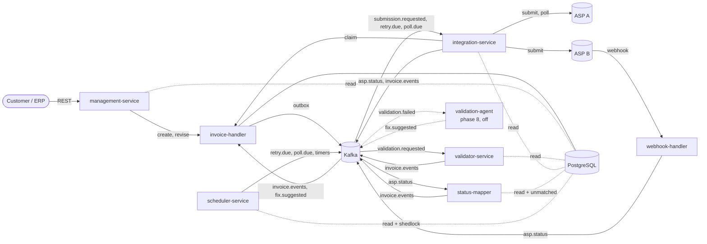
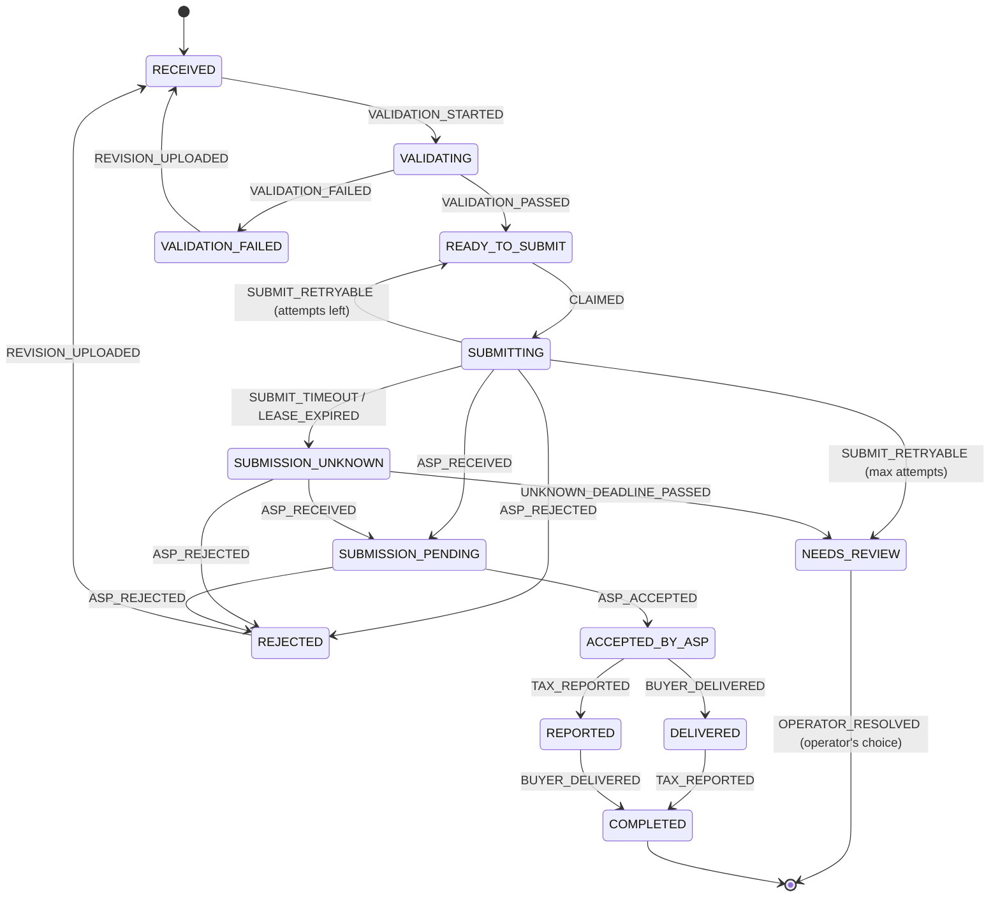
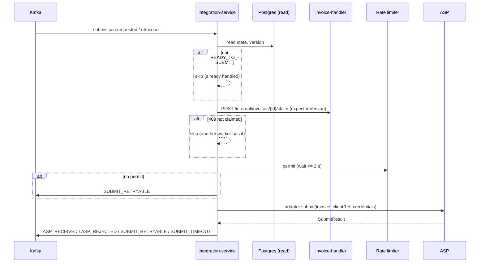
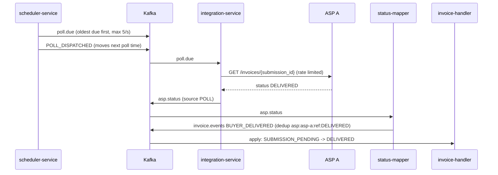
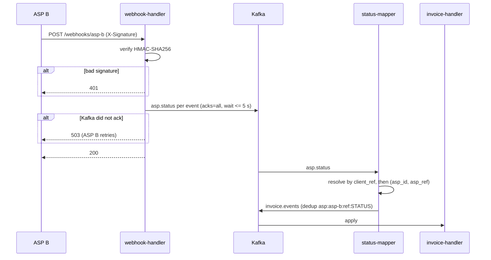

# How Finkraft works

This document explains how the system is put together and why, from the moment an invoice is uploaded until it is COMPLETED. It covers the architecture, every service, the invoice lifecycle, messaging, data, failure handling, configuration, observability and testing.

Related documents:

- [README](../README.md): how to build, test and run.
- [ASSUMPTIONS.md](ASSUMPTIONS.md): every decision taken where the build spec is silent, and open questions.
- [PROGRESS.md](PROGRESS.md): what was built in each phase.
- API reference (OpenAPI 3.1): [public API](api/public-api.openapi.json), [internal API](api/internal-api.openapi.json), [webhook API](api/webhook-api.openapi.json). Swagger UI is served by each of those services at `/swagger-ui.html`.

---

## 1. What Finkraft does

UAE e-invoicing requires invoices to reach the tax authority through an Accredited Service Provider (ASP). Finkraft sits between a business and its ASP:

1. A customer (tenant) uploads invoices over a REST API, one at a time or in bulk.
2. Finkraft puts each invoice into one canonical form, checks it against PINT AE rules, and rejects duplicates.
3. It submits the invoice to the seller's ASP, exactly once, respecting the ASP's rate limit.
4. It follows the invoice at the ASP (by polling or by webhooks) until the buyer has received it and the tax authority has it, which is COMPLETED.
5. When something cannot be resolved automatically, the invoice stops in NEEDS_REVIEW with a full audit trail.

Two ASPs are supported, and they behave very differently on purpose:

| | ASP A | ASP B |
|---|---|---|
| Status updates | Finkraft polls `GET /invoices/{id}` | ASP B calls Finkraft's webhook |
| Duplicate protection | Yes: a second POST with the same invoice number returns 409 and the existing id | None: every POST is a new submission |
| Rate limit | 10 requests/s | Not published |
| Safe to resend after a timeout? | Yes (its dedup catches the resend) | No (a resend could submit twice) |

Finkraft talks only to the ASP (corner 2 of the five-corner model). It does not do Peppol AS4 exchange, ERP integration, or talk to the buyer's ASP or the tax authority directly.

---

## 2. Architecture



### Principles

- **One writer.** Only `invoice-handler` changes invoice data. Everyone else reads the database and sends events. This is enforced by Postgres roles, not by convention (R3).
- **Asynchronous by default.** Every message between services goes through Kafka. The only synchronous calls are management-service creating or revising an invoice, and integration-service claiming one, both on the InvoiceHandler's internal API.
- **Events carry facts; the handler decides.** Producers say "the ASP said ACCEPTED" or "the lease expired". Only the InvoiceHandler, through the state machine, decides what that means for the invoice.
- **ASP knowledge is quarantined.** Only `libs/asp-adapters` knows ASP URLs, payloads, status names and error shapes (R6).

### Modules

| Module | Kind | Responsibility |
|---|---|---|
| `libs/canonical-model` | Library | `CanonicalInvoice`, `InvoiceState`, `CanonicalEvent`, `AspError`, canonicaliser, content hash, duplicate rule |
| `libs/state-machine` | Library, pure Java | `InvoiceStateMachine`: the transition table and the rank rule |
| `libs/event-contracts` | Library | `EventEnvelope`, topic names, payload records, dedup key formats, JSON codec, internal API request/response records |
| `libs/adapter-api` | Library | `AspAdapter` interface and its types (`SubmitResult`, `StatusUpdate`, ...) |
| `libs/asp-adapters` | Library | `AspAAdapter`, `AspBAdapter`, `AspCatalog` (static capabilities) |
| `libs/service-support` | Library | Shared Spring wiring: Kafka defaults, topics, error handler with dead-letter topics, `EventPublisher`, MDC helper, structured logs |
| `services/management-service` | Service :8080 | Public REST API, tenants, sellers, ASP routing, bulk upload, API-key auth |
| `services/invoice-handler` | Service :8081 | Single writer, internal API, state machine application, outbox relay, Flyway schema |
| `services/validator-service` | Service :8082 | Deterministic PINT AE rules |
| `services/integration-service` | Service :8083 | Submit flow, polls, shared rate limiter |
| `services/status-mapper` | Service :8084 | Raw ASP status to canonical event for one invoice |
| `services/webhook-handler` | Service :8085 | ASP B webhook endpoint |
| `services/scheduler-service` | Service :8086 | Turns due timers into Kafka events |
| `services/validation-agent` | Service :8087 | LLM fix suggestions; phase 8, disabled |
| `test-support/mock-asp-a`, `mock-asp-b` | Test apps | In-memory ASPs with fault injection |
| `test-support/scenario-tests` | Tests | End-to-end scenarios S1 to S19 |

Libraries never depend on services, and services never depend on each other, only on libraries and Kafka topics.

### Tech stack

Java 21, Spring Boot 3.5 (Web, Data JPA, JDBC, Kafka, Validation, Actuator), PostgreSQL 16 with Flyway, Apache Kafka 3.9 in KRaft mode, Resilience4j rate limiter, ShedLock (JDBC), Jackson, springdoc-openapi, Micrometer with Prometheus, JUnit 5, AssertJ, Testcontainers, Awaitility, WireMock. Gradle 9 (Kotlin DSL) with one version catalog.

---

## 3. The invariants and how they are enforced

These are the eight rules the system must never break. Each has at least one test that fails if it is broken.

| ID | Rule | How the code enforces it | Proven by |
|---|---|---|---|
| R1 | No invoice is lost. | State change and outbox row commit in one transaction (`Transitions`, `OutboxWriter`). The outbox relay marks a row published only after Kafka's ack. Consumers commit offsets only after the handler returns (`ack-mode: record`, auto-commit off). The webhook answers 200 only after Kafka's ack. | `OutboxRelayIT`, S5, S19 |
| R2 | No invoice is submitted twice to an ASP. | Unique (seller_id, invoice_number). Compare-and-set claim from READY_TO_SUBMIT to SUBMITTING on `version` before any ASP call. ASP B is never resent after a timeout. A dead worker's lease expires into SUBMISSION_UNKNOWN, never back to READY_TO_SUBMIT. | `ClaimConcurrencyIT`, S3, S4, S9, S10, S11 |
| R3 | Only the InvoiceHandler writes invoice data. | Each service connects as its own Postgres role. Only `invoice_handler` has INSERT/UPDATE on the lifecycle tables; `audit_log` is insert-only for everyone, backed by a trigger. | `RoleGrantsIT` (T-R3) |
| R4 | Every transition is legal. | One table-driven `InvoiceStateMachine`. Anything outside the table throws `InvalidTransitionException`; the transaction rolls back, so nothing changes, and the record goes to the dead-letter topic. | `InvoiceStateMachineTest` (all pairs), S18 |
| R5 | Every consumer is idempotent. | Every event carries a `dedupKey`; the handler inserts it into `processed_events` (primary key) in the same transaction as the change. A repeat is a no-op. | `DedupAndDeadLetterIT`, S7, S9 |
| R6 | No ASP-specific type crosses an adapter boundary. | Only canonical types leave `asp-adapters`; raw ASP bodies are kept as strings for audit only. | Module dependencies; adapter tests |
| R7 | Agents never change tax state. | `fix.suggested` is stored as a suggestion; the state machine maps FIX_SUGGESTED to "no change" in every state. | `DedupAndDeadLetterIT.fixSuggestionIsRecordedWithoutTransition` |
| R8 | One InvoiceHandler event at a time per invoice. | Kafka topics into the handler are keyed by invoice_id (one partition, in order); every update checks the JPA `@Version`. | `ClaimConcurrencyIT`, version-conflict retry |

---

## 4. The invoice lifecycle

### States

| State | Meaning |
|---|---|
| RECEIVED | Stored; about to be validated |
| VALIDATING | Waiting for the validator |
| VALIDATION_FAILED | Finkraft's own rules failed; the customer must upload a revision |
| READY_TO_SUBMIT | Valid, routed to an ASP, waiting for a worker to claim it |
| SUBMITTING | Claimed by one worker, which is calling the ASP; protected by a lease |
| SUBMISSION_PENDING | The ASP has it (we have its reference) and is processing |
| SUBMISSION_UNKNOWN | We do not know whether the ASP received it (timeout or dead worker) |
| ACCEPTED_BY_ASP | The ASP accepted it |
| REJECTED | The ASP rejected it; the customer may upload a revision |
| DELIVERED | Delivered to the buyer |
| REPORTED | Reported to the tax authority |
| COMPLETED | Both delivered and reported |
| NEEDS_REVIEW | Needs a human: retries exhausted, outcome unknown past the deadline, or the ASP contradicted itself |



Not drawn: ASP_REJECTED from ACCEPTED_BY_ASP, DELIVERED, REPORTED or COMPLETED goes to NEEDS_REVIEW (the ASP contradicted itself).

### Events

VALIDATION_STARTED, VALIDATION_PASSED, VALIDATION_FAILED, CLAIMED, SUBMIT_RETRYABLE, SUBMIT_TIMEOUT, LEASE_EXPIRED, ASP_RECEIVED, ASP_ACCEPTED, ASP_REJECTED, BUYER_DELIVERED, TAX_REPORTED, UNKNOWN_DEADLINE_PASSED, REVISION_UPLOADED, OPERATOR_RESOLVED, FIX_SUGGESTED, POLL_DISPATCHED.

Two events never change state: FIX_SUGGESTED (R7) and POLL_DISPATCHED (only moves the next poll time forward).

### The rank rule: out-of-order and skipped ASP statuses

ASP statuses arrive late, twice, out of order, or skip steps (a poll may miss a status). The rank rule absorbs this without errors.

| ASP event | Rank | | State | Rank |
|---|---|---|---|---|
| ASP_RECEIVED | 1 | | SUBMITTING, SUBMISSION_UNKNOWN | 0 |
| ASP_ACCEPTED | 2 | | SUBMISSION_PENDING | 1 |
| BUYER_DELIVERED | 3 | | ACCEPTED_BY_ASP | 2 |
| TAX_REPORTED | 3 | | DELIVERED, REPORTED | 3 |
| | | | COMPLETED | 4 |

`InvoiceStateMachine.next(state, event)` works like this:

1. If (state, event) is in the transition table, use the table. This is how DELIVERED + TAX_REPORTED becomes COMPLETED even though both have rank 3.
2. Otherwise, for a ranked event in a ranked state:
   - event rank above state rank: jump to the event's own state, skipping the states in between. TAX_REPORTED in SUBMISSION_PENDING goes straight to REPORTED, and the audit row records `impliedStates: [ACCEPTED_BY_ASP]`.
   - event rank at or below state rank: no-op. The dedup key is recorded, an audit row with outcome NO_OP_RANK is written, and there is no error. Example: a late ASP_RECEIVED after ACCEPTED_BY_ASP.
3. Anything else throws `InvalidTransitionException`.

ASP_REJECTED is not ranked; it always follows the table.

### Side effects of entering a state

All in the same database transaction as the state change (`Transitions.apply`):

| Entering | Also done |
|---|---|
| VALIDATING | Outbox `validation.requested` |
| VALIDATION_FAILED | Outbox `validation.failed` with the errors |
| READY_TO_SUBMIT after VALIDATION_PASSED | Pin `asp_id` from the active `asp_configs` row, generate `client_ref`, outbox `submission.requested`, set a safety-net `next_attempt_at = now + lease` |
| READY_TO_SUBMIT after SUBMIT_RETRYABLE | `next_attempt_at = now + backoff` (exponential, 20 % jitter) |
| SUBMISSION_PENDING, ACCEPTED_BY_ASP, DELIVERED, REPORTED | For POLL ASPs, schedule the first poll and reset the poll counter |
| SUBMISSION_UNKNOWN | `deadline_at = now + reconcile window` |
| DELIVERED, REPORTED, COMPLETED | Set `delivered_at` / `reported_at` from the event time |
| Any state | Store the ASP reference the first time an event carries one |

---

## 5. End to end, step by step

### 5.1 Intake (management-service to invoice-handler)

1. The customer calls `POST /api/v1/invoices` with `X-Api-Key`. `ApiKeyFilter` hashes the key (SHA-256) and looks up the tenant; unknown keys get 401.
2. `InvoiceParser` reads the JSON (or each CSV / JSON-array row for bulk) into a `CanonicalInvoice` and canonicalises it: strings trimmed, currency upper case, decimals with at least two places.
3. The seller is resolved by `sellerTrn` within the tenant (422 UNKNOWN_SELLER otherwise).
4. management-service calls `POST /internal/invoices` on the InvoiceHandler.
5. `InvoiceLifecycleService.create` computes the content hash and applies the duplicate rule (section 9):
   - New invoice: insert the invoice (RECEIVED) and revision 1, apply VALIDATION_STARTED (to VALIDATING), write the outbox row `validation.requested` and two audit rows, all in one transaction. Returns 201.
   - Replay: returns 200 with the existing invoice and emits nothing.
   - Duplicate number: 409 DUPLICATE_INVOICE_NUMBER.
6. Two concurrent uploads of the same new number: one insert wins and the other hits the unique constraint. The controller re-runs the duplicate rule, which then answers replay or 409.

### 5.2 Validation (validator-service)

1. The outbox relay publishes `validation.requested` (key: invoice_id).
2. `ValidationListener` loads that revision from `invoice_revisions` and runs every `ValidationRule` bean, in rule-id order.
3. It publishes VALIDATION_PASSED or VALIDATION_FAILED, with the errors, to `invoice.events` and dedup key `val:{invoiceId}:{revision}:{PASSED|FAILED}`.
4. The InvoiceHandler applies it. On pass: route, pin the ASP, generate `client_ref`, and emit `submission.requested`. On failure: emit `validation.failed`, the input of the future validation agent.

### 5.3 Submission (integration-service)



1. **Read.** If the invoice is not READY_TO_SUBMIT, skip; an earlier delivery already handled it.
2. **Claim.** `POST /internal/invoices/{id}/claim` runs one SQL statement:
   `UPDATE invoices SET state='SUBMITTING', version=version+1, attempt_count=attempt_count+1, lease_expires_at=now()+lease WHERE id=? AND state='READY_TO_SUBMIT' AND version=?`.
   Exactly one caller updates the row. This makes duplicate Kafka deliveries and racing workers harmless (R2).
3. **Rate limit.** Take a permit from the ASP's limiter, which is shared by submits and polls (ASP A: 8/s, one permit every 125 ms). No permit within 2 s means the request was provably never sent, so SUBMIT_RETRYABLE.
4. **Submit.** The adapter turns the canonical invoice into the ASP's format and classifies the result:

| Adapter outcome | Means | Event published |
|---|---|---|
| RECEIVED | The ASP took it | ASP_RECEIVED with the ASP reference |
| DUPLICATE | ASP A already had it (409 with its id) | ASP_RECEIVED with that reference |
| REJECTED | The ASP refused the content | ASP_REJECTED with errors |
| RETRYABLE | Provably not received (429, connection refused, 401/403) | SUBMIT_RETRYABLE |
| UNKNOWN | May have been received (read timeout, 5xx) | ASP A: resend at 1 s, 2 s, 4 s (its dedup makes this safe); still unknown, SUBMIT_TIMEOUT. ASP B: SUBMIT_TIMEOUT at once, never resent |

Dedup key: `submit:{invoiceId}:{attemptCount}:{outcome}`. SUBMIT_RETRYABLE and SUBMIT_TIMEOUT carry `expectedState = SUBMITTING`; if the lease already expired, they are recorded as stale no-ops.

5. **Retries.** SUBMIT_RETRYABLE moves the invoice back to READY_TO_SUBMIT with `next_attempt_at = now + backoff` (30 s base, factor 2, max 30 min, 20 % jitter). The Scheduler sends `retry.due` when that time passes, and the same flow runs again. After 6 attempts the invoice goes to NEEDS_REVIEW.

### 5.4 Following the invoice at ASP A (polling)



- Polls start 30 s after each status change and double up to 15 min (`finkraft.poll.schedule`).
- The Scheduler dispatches at most `max-polls-per-second` per tick, oldest due first, so every invoice gets its turn even when many are pending.
- Repeated polls of an unchanged status share a dedup key, so the InvoiceHandler applies each distinct status once.
- ASP A status map: RECEIVED → ASP_RECEIVED, VALIDATED → ASP_ACCEPTED (ASP A's own check, never Finkraft's validation), REJECTED → ASP_REJECTED, DELIVERED → BUYER_DELIVERED, REPORTED → TAX_REPORTED.

### 5.5 Following the invoice at ASP B (webhooks)



- Every submission to ASP B carries `client_reference` = the invoice's `client_ref`, and ASP B echoes it in webhooks. That is how an invoice in SUBMISSION_UNKNOWN (we never saw a job id) is still matched (S4).
- ASP B status map: QUEUED → ASP_RECEIVED, ACCEPTED → ASP_ACCEPTED, FAILED → ASP_REJECTED, BUYER_RECEIVED → BUYER_DELIVERED, TAX_CONFIRMED → TAX_REPORTED.
- `asp.status` is keyed by the ASP reference, because a webhook may carry nothing else. The status mapper republishes to `invoice.events` keyed by invoice_id, which restores per-invoice ordering before the InvoiceHandler.

### 5.6 Corrections (revisions)

When an invoice is VALIDATION_FAILED or REJECTED, the customer sends `POST /api/v1/invoices/{id}/revisions` with a corrected invoice (same number) or the id of a fix suggestion to approve. The InvoiceHandler stores revision n+1, clears everything tied to the old submission (ASP, reference, attempts, timers), applies REVISION_UPLOADED (to RECEIVED) and VALIDATION_STARTED, and dismisses other pending suggestions. The invoice then goes through validation and submission again (S14). Uploading the same number again through `POST /api/v1/invoices` with new content does the same thing while the invoice is failed or rejected.

---

## 6. Messaging

### Envelope

Every message on every topic is an `EventEnvelope` serialised as JSON:

```json
{
  "eventId": "uuid",
  "type": "VALIDATION_PASSED",
  "invoiceId": "uuid or null",
  "tenantId": "uuid or null",
  "dedupKey": "val:...:1:PASSED",
  "occurredAt": "2026-10-31T10:00:00Z",
  "producer": "validator-service",
  "payload": { }
}
```

### Topics

| Topic | Key | Producer | Consumer | Payload |
|---|---|---|---|---|
| `validation.requested` | invoice_id | invoice-handler (outbox) | validator-service | invoiceId, revision |
| `validation.failed` | invoice_id | invoice-handler (outbox) | validation-agent | invoiceId, revision, errors |
| `fix.suggested` | invoice_id | validation-agent | invoice-handler | invoiceId, revision, suggestion |
| `submission.requested` | invoice_id | invoice-handler (outbox) | integration-service | invoiceId, aspId |
| `retry.due` | invoice_id | scheduler-service | integration-service | invoiceId |
| `poll.due` | invoice_id | scheduler-service | integration-service | invoiceId, aspId, aspRef |
| `asp.status` | asp_ref | webhook-handler, integration-service | status-mapper | aspId, aspRef, clientRef, rawStatus, rawBody, source, receivedAt, errors |
| `invoice.events` | invoice_id | validator, integration, status-mapper, scheduler | invoice-handler | event, data (errors, aspRef, rawStatus, rawBody, occurredAt, expectedState, targetState, attemptCount) |
| `<topic>.DLT` | same | consumer error handler | operators | the failed record |

Every topic has 12 partitions locally (replication factor 3 and `min.insync.replicas=2` belong to phase 7).

### Dedup keys

| Source | Format |
|---|---|
| ASP status | `asp:{aspId}:{aspRef}:{rawStatus}` |
| Validation result | `val:{invoiceId}:{revision}:{result}` |
| Submit outcome | `submit:{invoiceId}:{attemptCount}:{outcome}` |
| Timer | `timer:{invoiceId}:{timerType}:{dueAt}` |

### Client settings

- Producers: `acks=all`, `enable.idempotence=true`.
- Consumers: `enable.auto.commit=false`, `isolation.level=read_committed`, offsets committed per record only after the handler returns.

These defaults live in `FinkraftDefaultsPostProcessor` (service-support), so every service gets them.

### The transactional outbox

The InvoiceHandler never sends to Kafka inside a business transaction. It writes an `outbox` row in the same transaction as the state change. `OutboxRelay` runs every 500 ms:

1. It selects up to 100 unpublished rows in id order with `FOR UPDATE SKIP LOCKED`.
2. It sends each one, keyed by invoice_id, and waits for the ack.
3. It marks the sent rows published.

A failed send stops the batch, so later rows for the same invoice never overtake it, and the row is retried next run. Messages are published at least once; consumers are idempotent, so duplicates are harmless.

### Error handling and dead letters

`KafkaSupportAutoConfiguration` installs one `DefaultErrorHandler` in every service:

- An ordinary failure (database down, version conflict after 3 in-place retries) is retried in place 3 times, 1 s apart; the offset is not committed meanwhile. Then the record goes to `<topic>.DLT`.
- A poison record (`PoisonEventException`: illegal transition, unmapped ASP status, unknown invoice, undecodable JSON) goes to the DLT at once.

Nothing is silently dropped: a record either takes effect or lands in a DLT with its exception in the headers.

---

## 7. Data model

One PostgreSQL database. The schema is created only by Flyway, in `services/invoice-handler/src/main/resources/db/migration`:

- `V1__roles.sql`: one login role per service (passwords are Flyway placeholders).
- `V2__schema.sql`: tables, indexes, grants and the audit trigger.

### Tables and who may write them

| Table | Purpose | Writer |
|---|---|---|
| `invoices` | Current state of every invoice: canonical JSON, state, version, ASP pinning, references, attempt and poll counters, timers, timestamps | invoice_handler |
| `invoice_revisions` | Every uploaded revision (invoice_id, revision) with its hash and canonical JSON | invoice_handler |
| `outbox` | Events waiting to be published | invoice_handler |
| `audit_log` | Every transition, no-op and decision, with the raw event; insert-only | invoice_handler (INSERT only) |
| `processed_events` | Dedup keys already applied (R5) | invoice_handler |
| `fix_suggestions` | Agent suggestions: PENDING_CUSTOMER, APPROVED, DISMISSED | invoice_handler |
| `tenants` | Customers; API keys stored as SHA-256 hashes | management |
| `sellers` | Legal entities with a TRN; one tenant can have several | management |
| `asp_configs` | Routing (seller, asp_id, effective_from, enabled) | management |
| `asp_credentials` | Reference to the seller's ASP secret, never the secret | management |
| `unmatched_asp_status` | ASP statuses that did not match an invoice yet | status_mapper |
| `shedlock` | Scheduler lock | scheduler |

Every service role can read the lifecycle and management tables. `RoleGrantsIT` connects as every non-owner role and checks that every write to a lifecycle table fails with SQLSTATE 42501 (permission denied).

### Key columns of `invoices`

`id, tenant_id, seller_id, invoice_number, revision, content_hash, canonical (jsonb), state, version, asp_id, asp_ref, client_ref, attempt_count, poll_count, next_attempt_at, lease_expires_at, deadline_at, delivered_at, reported_at, possible_duplicate_of, created_at, updated_at`

Unique (seller_id, invoice_number). Indexes on (seller_id, content_hash), (state, next_attempt_at), (state, lease_expires_at), (state, deadline_at), (asp_id, asp_ref), client_ref and (tenant_id, state).

### Java classes for the database

Only the `invoices` table is a JPA entity (`InvoiceEntity`, with `@Version` for optimistic locking). Every other table is accessed with `JdbcTemplate` and plain SQL, because the code needs exact statements: the compare-and-set claim, `FOR UPDATE SKIP LOCKED`, `ON CONFLICT DO NOTHING`, and insert-only tables.

---

## 8. Each service in detail

### management-service

- **Public API:** see the [OpenAPI spec](api/public-api.openapi.json) or Swagger UI at `/swagger-ui.html`.
- **Auth:** `X-Api-Key` for invoice endpoints (resolved to a tenant by hash; every query is filtered by tenant_id), and `X-Admin-Key` for admin endpoints.
- **Bulk:** a JSON array of canonical invoices, or CSV with one single-line invoice per row. Up to 1,000 rows; each row is processed independently with its own result (created, replay, revision, duplicate_rejected, parse_error).
- Writes only management tables; creates and revises invoices only through the InvoiceHandler.

### invoice-handler

- **Internal API** ([spec](api/internal-api.openapi.json)): create, revise, claim.
- **Consumers:** `invoice.events` (3 threads) and `fix.suggested`.
- **Applying an event** (`InvoiceEventService`), all in one transaction:
  1. Insert the dedup key. If it already exists, the event was applied: stop.
  2. Load the invoice. If the event carries `expectedState` and the invoice is elsewhere, record a stale no-op and stop.
  3. Ask the state machine. If the transition is illegal, roll back and dead-letter.
  4. Apply the side effects, flush the update with its version check, then write the audit and outbox rows.

  On a version conflict the whole transaction is retried up to 3 times with fresh data, then the error handler takes over.
- **Outbox relay** (section 6).
- **Metrics:** invoices by state and age, outbox lag.

### validator-service

Deterministic rules; the same input always gives the same errors. Each error is `AspError(code=ruleId, field, rule=ruleId, message)`.

| Rule | Check |
|---|---|
| FK-R001 | Required fields present: TRNs, number, date, currency, at least one line with all its fields, all three totals |
| FK-R002 | Seller and buyer TRN are 15 digits |
| FK-R003 | Issue date not in the future (UAE time) |
| FK-R004 | Currency is a valid ISO 4217 code |
| FK-R005 | lineNet = quantity x unitPrice (scale 2, HALF_UP) |
| FK-R006 | lineVat = lineNet x vatRate / 100 (scale 2, HALF_UP); vatRate is a percentage |
| FK-R007 | netTotal and vatTotal equal the sums of the lines; grossTotal = netTotal + vatTotal |
| FK-R008 | VAT category and rate are a permitted pair: S 5 %, Z 0 %, E 0 %, O 0 % |

### integration-service

- **Consumers:** `submission.requested` (4 threads), `retry.due` (2) and `poll.due` (2); thread counts are kept low so waits on the shared limiter rarely exceed the permit wait.
- **Submit and poll flows:** sections 5.3 and 5.4.
- **Credentials:** `asp_credentials.secret_ref`, resolved from `finkraft.secrets.values` (a secrets manager in phase 7).
- **Stale polls:** a `poll.due` older than 30 s is dropped; a newer one is already queued.
- **Metrics:** `finkraft.asp.calls{asp, operation, outcome}` records ASP latency and errors.

### status-mapper

- Converts a raw status with the adapter (an unknown status is dead-lettered, never guessed).
- Resolves the invoice by `client_ref`, then by (asp_id, asp_ref), and publishes the canonical event.
- **No match** (for example, a webhook that overtook the submit response and has no client reference): the status is parked in `unmatched_asp_status`. A job retries matching every minute; after 24 h it logs an ALERT and stops. Parked rows are marked matched or alerted, never deleted (S17).

### webhook-handler

`POST /webhooks/asp-b` ([spec](api/webhook-api.openapi.json)):

- Verifies the HMAC-SHA256 signature of the raw body (header `X-Signature`, configurable); a bad signature gets 401.
- Publishes one `asp.status` per event and waits for every ack (5 s), then answers 200.
- If Kafka does not ack, it answers 503 so ASP B retries. It never answers 200 before the ack.

### scheduler-service

Every 5 s, under a ShedLock lock (only one instance acts), it reads due rows (read-only) and publishes:

| Condition | Publishes |
|---|---|
| READY_TO_SUBMIT and `next_attempt_at <= now` | `retry.due` |
| SUBMITTING and `lease_expires_at <= now` | `invoice.events` LEASE_EXPIRED |
| SUBMISSION_UNKNOWN and `deadline_at <= now` | `invoice.events` UNKNOWN_DEADLINE_PASSED |
| POLL ASP in SUBMISSION_PENDING, ACCEPTED_BY_ASP, DELIVERED or REPORTED, and `next_attempt_at <= now` | `poll.due` then POLL_DISPATCHED (at most 5 per second, oldest first) |
| WEBHOOK ASP: SUBMISSION_PENDING longer than 30 min, or not reported within 24 h | `finkraft.sla.breaches` metric and an ALERT log line; no state change |

It never writes invoice tables: the InvoiceHandler moves the timers when it applies the events. Repeated dispatches of the same due time share a dedup key.

### validation-agent (phase 8, disabled)

It will consume `validation.failed`, ask an LLM for a correction, and publish `fix.suggested`. It has no database write access and no internal API access, so it can only suggest (R7). Today it is an empty app with `agent.enabled=false`.

---

## 9. Duplicates and the content hash

**Content hash.** SHA-256 hex over a canonical JSON form of the business content:

- keys sorted
- strings trimmed
- currency and VAT category upper case
- dates ISO-8601
- every decimal as a plain string with at least two decimals and no rounding ("100" and "100.00" match; "100.125" stays distinct)

Finkraft-only fields (ids, timestamps, state) and the invoice number are excluded.

**Duplicate rule** (`DuplicateRule.decide`, backed by the unique constraint):

| Same number? | Same hash? | Result |
|---|---|---|
| Yes | Yes | Idempotent replay: return the existing invoice, emit nothing (200) |
| Yes | No | 409 DUPLICATE_INVOICE_NUMBER, unless the existing invoice is VALIDATION_FAILED or REJECTED, in which case it becomes a new revision (201) |
| No | Yes | Created with `possible_duplicate_of` set and a POSSIBLE_DUPLICATE warning (201) |
| No | No | Created (201) |

---

## 10. What happens when things go wrong

| Situation | What the system does | Scenario |
|---|---|---|
| ASP A times out after accepting | Resend after 1 s; ASP A answers 409 with the existing id; ASP_RECEIVED. One invoice at ASP A. | S3 |
| ASP B times out after accepting | SUBMIT_TIMEOUT to SUBMISSION_UNKNOWN; never resent. A webhook with `client_reference` matches it and moves it on. | S4 |
| ASP B times out and stays silent | NEEDS_REVIEW when the reconcile window (30 min) passes. Still exactly one POST. | S5 |
| Worker dies after claiming | The lease (2 min) expires: LEASE_EXPIRED to SUBMISSION_UNKNOWN, never back to READY_TO_SUBMIT (the ASP may have it). | S11 |
| `submission.requested` delivered twice, or two workers race | The claim lets exactly one through. | S9, S10 |
| ASP rate limit | One permit every 125 ms (8/s under ASP A's 10/s). No permit in 2 s: SUBMIT_RETRYABLE with backoff. | S12 |
| ASP statuses out of order or skipped | Rank rule: skip ahead, or no-op for stale ones. | S6, S8 |
| Same webhook twice | Same dedup key: applied once, one audit row. | S7 |
| ASP says REJECTED after ACCEPTED | NEEDS_REVIEW; both raw payloads are in the audit log. | S15 |
| Forged or unsigned webhook | 401, nothing published. | S16 |
| Webhook overtakes the 202 | Parked in `unmatched_asp_status`, matched once the reference is stored. | S17 |
| Illegal event | Nothing changes; the record goes to `invoice.events.DLT`. | S18 |
| Kafka down when a webhook arrives | 503; ASP B retries later. | S19 |
| Kafka down for the InvoiceHandler | Outbox rows wait; the relay resumes from the oldest. | `OutboxRelayIT` |
| Timer fires after the invoice moved on | Recorded as a stale no-op (NO_OP_STALE), not an error. | `DedupAndDeadLetterIT` |
| Two updates to one invoice at once | The `@Version` check fails one; it is retried with fresh data. | `ClaimConcurrencyIT` |
| No active route for a seller | The VALIDATION_PASSED event fails and is retried, then dead-lettered; the invoice stays VALIDATING. | — |
| 6 retryable failures in a row | NEEDS_REVIEW. | — |

---

## 11. Configuration reference

All keys are under `finkraft.*` in each service's `<service-name>.yml` and can be overridden by environment variables (for example `FINKRAFT_SUBMIT_MAX_ATTEMPTS=8`).

| Key | Default | Used by |
|---|---|---|
| `finkraft.asp.a.rate-limit-rps` | 8 | integration-service (shared by submits and polls) |
| `finkraft.asp.b.rate-limit-rps` | 0 (none) | integration-service |
| `finkraft.asp.permit-wait` | 2s | integration-service |
| `finkraft.asp.connect-timeout` / `read-timeout` | 2s / 10s | asp-adapters |
| `finkraft.asp.a.timeout-resends` | 1s, 2s, 4s | integration-service (ASP A only) |
| `finkraft.asp.a.base-url`, `finkraft.asp.a.api-key` | env `ASP_A_URL`, `ASP_A_STATUS_KEY` | adapters (status reads use Finkraft's key) |
| `finkraft.asp.b.base-url`, `webhook-secret`, `signature-header` | env `ASP_B_URL`, `ASP_B_WEBHOOK_SECRET`, `X-Signature` | adapters, webhook-handler |
| `finkraft.submit.max-attempts` | 6 | invoice-handler |
| `finkraft.submit.backoff.base` / `factor` / `max` / `jitter` | 30s / 2 / 30m / 0.2 | invoice-handler |
| `finkraft.submit.lease` | 2m | invoice-handler (claim) |
| `finkraft.reconcile.window` | 30m | invoice-handler (SUBMISSION_UNKNOWN deadline) |
| `finkraft.poll.schedule.first` / `max` | 30s / 15m | invoice-handler |
| `finkraft.outbox.interval` / `batch-size` | 500ms / 100 | invoice-handler |
| `finkraft.handler.version-conflict-retries` | 3 | invoice-handler |
| `finkraft.scheduler.interval` | 5s | scheduler-service |
| `finkraft.scheduler.max-polls-per-second` | 5 | scheduler-service |
| `finkraft.scheduler.batch-size` | 500 | scheduler-service |
| `finkraft.sla.asp-b.accepted` / `reported` | 30m / 24h | scheduler-service alerts |
| `finkraft.webhook.kafka-ack-timeout` | 5s | webhook-handler |
| `finkraft.unmatched.retention` / `retry-interval` | 24h / 1m | status-mapper |
| `finkraft.integration.poll-max-age` | 30s | integration-service |
| `finkraft.integration.submit-concurrency` / `retry-concurrency` / `poll-concurrency` | 4 / 2 / 2 | integration-service |
| `finkraft.secrets.values.<ref>` | dev values | integration-service |
| `finkraft.bulk.max-rows` | 1000 | management-service |
| `finkraft.admin.api-key` | env `ADMIN_API_KEY` | management-service |
| `finkraft.invoice-handler.url` | env `INVOICE_HANDLER_URL` | management-service, integration-service |
| `finkraft.kafka.retry.interval` / `attempts` | 1s / 3 | every consumer's error handler |
| `finkraft.kafka.partitions` / `replication-factor` | 12 / 1 | topic creation |
| `finkraft.metrics.refresh-interval` | 15s | invoice-handler metrics |
| `agent.enabled` | false | validation-agent |

Database and Kafka connection: `DB_URL`, `DB_USER`, `DB_PASSWORD`, `DB_OWNER_USER` / `DB_OWNER_PASSWORD` (Flyway only, in the InvoiceHandler), `KAFKA_BOOTSTRAP`.

---

## 12. Observability

- **Health:** `/actuator/health`, plus liveness and readiness probes, on every service.
- **Metrics:** `/actuator/metrics` and `/actuator/prometheus`; every metric is tagged `service`.

| Metric | What it tells you |
|---|---|
| `finkraft.invoices{state}` | How many invoices are in each state (watch NEEDS_REVIEW) |
| `finkraft.invoices.oldest.age{state}` | Seconds the oldest invoice has been in a state (stuck invoices) |
| `finkraft.outbox.unpublished`, `finkraft.outbox.lag` | Whether events are leaving the InvoiceHandler |
| `kafka.consumer.fetch.manager.records.lag.max` | Consumer lag per service |
| `finkraft.asp.calls{asp,operation,outcome}` | ASP latency and error rates (timer) |
| `finkraft.unmatched.open` | ASP statuses waiting for their invoice |
| `finkraft.sla.breaches{sla}` | ASP B invoices past their SLA |

- **Logs:** JSON (logstash format) on stdout. Every line logged while handling an invoice carries `invoice_id`, so one query shows an invoice's whole path across services. Alerts are logged with the prefix `ALERT`.
- **Audit trail:** `SELECT * FROM audit_log WHERE invoice_id = ? ORDER BY id` gives every transition, every no-op, the actor (service, worker or operator) and the raw event or ASP payload.
- **Dead letters:** `<topic>.DLT` topics.

---

## 13. Testing

`./gradlew build` runs everything (about 4 minutes; 300+ tests).

| Level | What | Examples |
|---|---|---|
| Unit | Pure logic, no containers | Every (state, event) pair of the state machine (203 cases); rank skips and no-ops; hash stability; duplicate table; each adapter outcome and status mapping against WireMock; each validator rule |
| Integration | invoice-handler against real Postgres and Kafka (Testcontainers) | Claim concurrency (20 races, one winner each); outbox commit/rollback; dedup; dead-lettering; stale timers; R7; role grants; JSON logs |
| Scenario | All services and both mocks in one JVM, each with its own config and database role | S1 to S19, bulk upload, tenant isolation, metrics, OpenAPI export |

The mocks are small Spring Boot apps with a control API (`/_control/faults`, `/_control/stats`). They can time out after accepting, reject, return 5xx, skip statuses, and, for ASP B, delay, reorder, duplicate, drop or send webhooks before the 202. Mock A enforces 10 rps with 429 and reports the peak rate it saw, which S12 asserts never exceeds 10.

Scenarios use shortened timings (lease 8 s, reconcile window 5 s, polls every 0.5 to 1 s) so the whole suite runs in minutes.

---

## 14. Known limitations and what comes next

- **Open question A9.** ASP A reports only its current status. If a poll sees REPORTED before Finkraft saw DELIVERED, the invoice stays REPORTED and keeps being polled. This needs a product decision; options are in [ASSUMPTIONS.md](ASSUMPTIONS.md).
- **In-process rate limiter.** Two integration-service instances each use the full ASP A budget. A shared, Redis-backed limiter is phase 7.
- **No operator endpoint.** OPERATOR_RESOLVED exists in the state machine, but there is no ops console yet (phase 7).
- **Phase 7 (production hardening):** circuit breakers, per-ASP consumer isolation, tenant fairness, Kafka replication and durability, Postgres HA, OpenTelemetry tracing, a secrets manager, row-level security, mTLS, an ops console.
- **Phase 8 (agent layer):** the validation agent behind its feature flag, and MCP servers.
